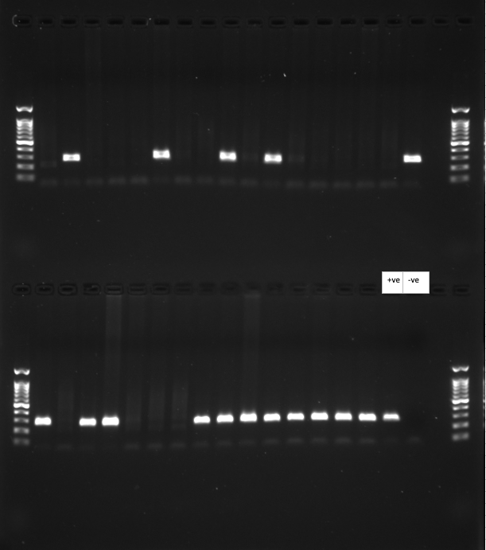

# VillinCre Genotyping 
2026-10-14

[Issue 1](https://github.com/chanmilee9496/tfcb_2026_demo/issues/1)

This experiment is to identify the presence of Villin-Cre transgene in mouse ear clip tissue, by PCR amplification and subsequent gel electrophoresis of mouse genomic DNA.
## Reagents

| reagent | vendor | catalog number | stock concentration | final concentration |
|---|---|---|---|---|
| SYBR Safe DNA gel stain | Invitrogen | S33102 | 10,000X | 0.5X |
| OneTaq 2x MasterMix | NewEngland Biolabs | M0482S | 2X | 1X |
| Villin-Cre primers | IDT | N/A custom primers | 100 µM | 10µM |
| 100 bp DNA ladder | GoldBio | D001-500 | 0.1 μg/μL | 0.1 μg/μL |

## Procedure 
1. Calculate how much of each reagent is needed, where each sample will be loaded into PCR tubes, and the final gel
1. To a 1ml tube, add in this order: H2O, Mastermix, Primers 
1. Label your strip tubes
1. Load the appropriate amount of DNA (2uL) into each well of the PCR strip tube(s), including controls. 
1. Add in the appropriate amount of master mix (18uL)
1. DO NOT BRING PRE-PCR RACKS/ETC TO PCR ROOM.
1. Run the PCR program: 94 °C for 30 seconds; 30 cycles of 94 °C for 20 seconds, 60 °C for 20 seconds, and 68 °C for 1 minute; 68 °C for 5 minutes; hold at 4 °C.
1. Measure out 1 gram of Agarose in erlenmeyer flask
1. Add 100mL of 1x TBE.
1. Swirl to mix 
1. Microwave 2 minutes, bubbles should dissipate without clumps when swirling. 
1. Add 5uL of SYBRSafe dye to gel solution
1. Pour into molds 
1. Let set until PCR is done (about one hour) in dark
1. Once PCR is done, remove gel from mold, place in gel electrophoresis box, and top off 1x TBE if needed
1. Load 5uL of ladder on each end of each row of the gel. Use 100bp ladder from Gold Bio.
1. Load 10uL of PCR product to each well
1. Run the gels at about 150V for 20 minutes in dark. 
1. Remove gel from box and take to ChemiDoc in utility hallway
1. Open Image Lab > New… > Application/Select… > Nucleic acid gels > SYBR Safe (keep all other settings standard) > Position gel > Run protocol
1. Save as both SCN file and Export for Publication (.tif)

## Result

Agarose gel of Villin-Cre genotyping PCR products from mouse ear clip DNA (mice 21V1 to 21G3), with 100 bp ladder. Image taken on the ChemiDoc by Chan Mi Lee.
